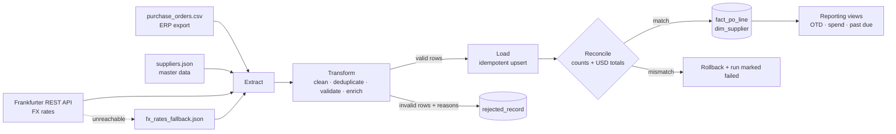

# Procurement ETL Pipeline (Python + PostgreSQL)

[](https://github.com/raimiruben/procurement-etl/actions/workflows/ci.yml)


An end-to-end ETL pipeline that takes the kind of messy purchase-order export an ERP produces, combines it with supplier master data and live exchange rates, validates every row, and loads a clean, reconciled dataset into PostgreSQL for supplier-performance and spend reporting.

The problem it solves comes from real supply-chain work: ERP reports arrive with mixed date formats, inconsistent codes, duplicated lines and broken values, and any KPI built on them is only as good as the cleaning behind it.

## What it does



| Step | Details |
|---|---|
| **Extract** | Reads a CSV (everything as text, so nothing is silently coerced), a nested JSON file, and ECB reference rates from the [Frankfurter API](https://frankfurter.dev). If the API is down, it falls back to a local file and records that in the run log. |
| **Transform** | Trims and normalizes codes (`' sup-001 '` → `SUP-001`), parses three date formats, handles thousands separators, removes exact duplicates, and checks 11 validation rules. Every failed rule is reported, not just the first one. |
| **Enrich** | Line amount in local currency and in USD, days late vs. promised date, on-time flag (left empty for lines not yet received, instead of counting them as late). |
| **Load** | Upserts into a small star-like schema with `ON CONFLICT`, so re-running the same file never duplicates data. Invalid rows go to a quarantine table as JSONB with their reasons. |
| **Reconcile** | Before committing, checks that every extracted row is accounted for (`extracted = duplicates + rejected + loaded`) and that row counts and USD totals in the database match the batch. Any mismatch rolls back the whole load and marks the run as `failed`. |
| **Audit** | Every execution writes a row to `etl_run_log`: timestamps, status, counts, FX source and date, error message. |

## Sample run

```
$ python -m procurement_etl.pipeline --offline

Run summary
  rows_extracted       608
  duplicates_removed   8
  rows_rejected        10
  rows_loaded          590
  fx_source            fallback_file
  fx_date              2026-09-30
  rejection_reasons    {'non_positive_quantity': 2, 'invalid_or_missing_order_date': 2,
                        'missing_or_invalid_unit_price': 2, 'unsupported_currency': 1,
                        'unknown_supplier': 1, 'missing_supplier_code': 1,
                        'received_before_order': 1}
  total_usd            1427306.91
```

```sql
SELECT supplier_code, supplier_name, received_lines, otd_pct, spend_usd
FROM procurement.vw_supplier_otd ORDER BY otd_pct;
```

```
 supplier_code |    supplier_name     | received_lines | otd_pct | spend_usd
---------------+----------------------+----------------+---------+-----------
 SUP-004       | Shenzhen Micro Parts |             86 |    60.5 | 229335.11
 SUP-003       | MedPack de Mexico    |             81 |    67.9 | 201249.52
 SUP-006       | Nordic Tubing AB     |             72 |    80.6 | 232918.10
 SUP-002       | Precision Wire GmbH  |             86 |    81.4 | 175475.78
 SUP-005       | Atlantic Resins Inc  |             61 |    91.8 | 125506.06
 SUP-001       | Caribe Plastics SRL  |             72 |    93.1 | 147576.28
 SUP-007       | Santo Domingo Labels |             74 |    95.9 | 196979.68
 SUP-008       | Legacy Metals Corp   |              1 |   100.0 |     84.40
```

## Quick start

Requirements: Python 3.11+, and Docker (or any PostgreSQL 14+ you already have).

```bash
# 1. Start PostgreSQL
docker compose up -d

# 2. Install dependencies (uv or pip)
uv sync                                 # or: python -m venv .venv && pip install -r requirements.txt

# 3. (Optional) regenerate the sample data - it is deterministic (seed 42)
uv run python scripts/generate_sample_data.py

# 4. Run the pipeline
uv run python -m procurement_etl.pipeline                     # latest FX rates from the API
uv run python -m procurement_etl.pipeline --fx-date 2026-09-30 # rates for a fixed date
uv run python -m procurement_etl.pipeline --offline            # no network, fallback rates
uv run python -m procurement_etl.pipeline --dry-run            # validate only, write nothing

# 5. Run the tests
uv run pytest -v
```

With plain pip, set `PYTHONPATH=src` (PowerShell: `$env:PYTHONPATH="src"`) before running the module.

Configuration is read from environment variables or a `.env` file (see `.env.example`): `DATABASE_URL`, `FX_API_URL`, `FX_TIMEOUT_SECONDS`.

## Data model

Schema `procurement` (see [`sql/01_schema.sql`](sql/01_schema.sql)):

| Table | Grain / purpose | Key |
|---|---|---|
| `fact_po_line` | One purchase-order line, with local and USD amounts and delivery performance | `(po_number, line_number)` |
| `dim_supplier` | Supplier master data, latest values win (type 1) | `supplier_code` |
| `rejected_record` | Quarantined rows as JSONB plus an array of reasons | `rejected_id` |
| `etl_run_log` | One row per pipeline execution | `run_id` |

Constraints in the database repeat the most important rules (`quantity > 0`, `promised_date >= order_date`, foreign key to `dim_supplier`), so bad data is blocked even if someone loads it outside the pipeline.

Reporting views ([`sql/02_views.sql`](sql/02_views.sql)):

- `vw_supplier_otd`: on-time delivery %, average lateness and spend per supplier
- `vw_spend_by_category_month`: monthly spend per category with share of the month (window function)
- `vw_open_past_due`: open lines already past their promised date

## Validation rules

| Rule | Example caught in the sample data |
|---|---|
| `missing_supplier_code` | blank supplier |
| `unknown_supplier` | `SUP-999` not in master data |
| `invalid_or_missing_order_date` | `31/02/2026`, blank |
| `invalid_or_missing_promised_date` | unparseable promised date |
| `invalid_received_date` | received date present but unparseable |
| `promised_before_order` | promised date earlier than order date |
| `received_before_order` | received 2025-12-01 for a 2026 order |
| `invalid_quantity` / `non_positive_quantity` | `-250`, `0` |
| `missing_or_invalid_unit_price` / `negative_unit_price` | blank, `abc` |
| `unsupported_currency` | `XYZ` |
| `duplicate_key_conflict` | same PO line twice with different values: both quarantined, since neither can be trusted |

Exact duplicate lines (a common side effect of re-exporting a report) are removed and counted separately. Orders placed with suppliers now marked inactive are loaded but logged as a warning, since historical orders to a supplier that is inactive today are legitimate.

## Tests

`pytest` runs 31 tests:

- **Unit tests** (`tests/test_transform.py`): date and number parsing, code normalization, each validation rule, duplicate handling, currency conversion, on-time logic.
- **Integration tests** (`tests/test_pipeline_integration.py`, skipped if no database is reachable):
  - running the pipeline twice gives identical results and no duplicated rows (idempotency);
  - a simulated partial load fails reconciliation, is rolled back, and the run is logged as `failed` with zero rows written.

GitHub Actions ([`.github/workflows/ci.yml`](.github/workflows/ci.yml)) starts a PostgreSQL service and runs the tests plus a full pipeline execution on every push.

## Project structure

```
├── data/raw/                 # sample inputs (synthetic) + FX fallback
├── scripts/generate_sample_data.py
├── sql/
│   ├── 01_schema.sql         # tables, constraints, indexes
│   └── 02_views.sql          # reporting views
├── src/procurement_etl/
│   ├── config.py             # settings from env / .env
│   ├── extract.py            # CSV, JSON, REST API (+ fallback)
│   ├── transform.py          # cleaning, validation, enrichment
│   ├── load.py               # upserts, quarantine, reconciliation, run log
│   └── pipeline.py           # CLI orchestration
├── tests/
├── docker-compose.yml
└── .github/workflows/ci.yml
```

## Design decisions

- **Read everything as text first.** Letting pandas guess types turns `"1,200"` or `"abc"` into `NaN` without a trace. Parsing explicitly means every bad value ends up with a named reason.
- **Quarantine instead of dropping.** Rejected rows are kept with their original content so someone can fix them at the source.
- **Reconcile before commit.** Loading inside one transaction and comparing counts and totals before committing means the database never holds a half-loaded batch.
- **Idempotent loads.** Upserting on the natural key makes re-runs and backfills safe.
- **Explicit fallback.** The pipeline keeps working when the FX API is down, but the run log says which rates were used.

## Possible next steps

- Incremental loads based on a change date instead of full-file reloads
- Rates per order date (historical FX) instead of a single rate date
- Orchestration with Airflow or Prefect, and data-quality checks with Great Expectations
- Type-2 history for supplier changes

## Data

All data in this repository is synthetic and generated by `scripts/generate_sample_data.py`. Supplier names are fictional. The FX fallback values are illustrative, not market data.

## License

MIT, see [LICENSE](LICENSE).
